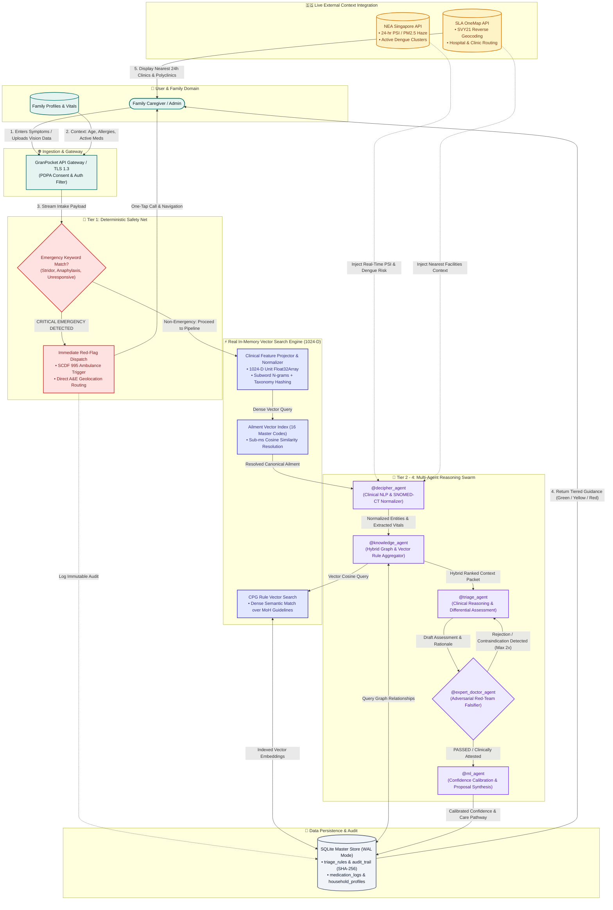
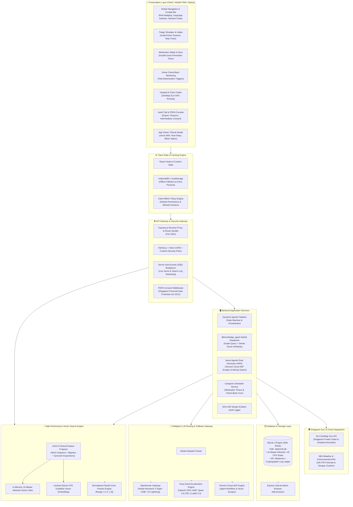
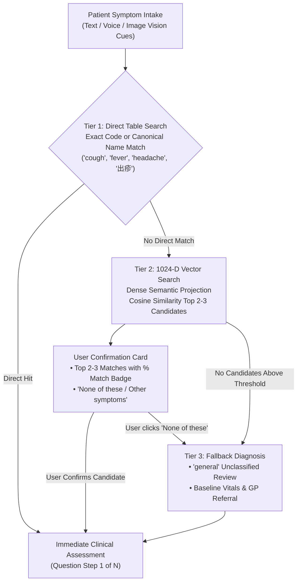
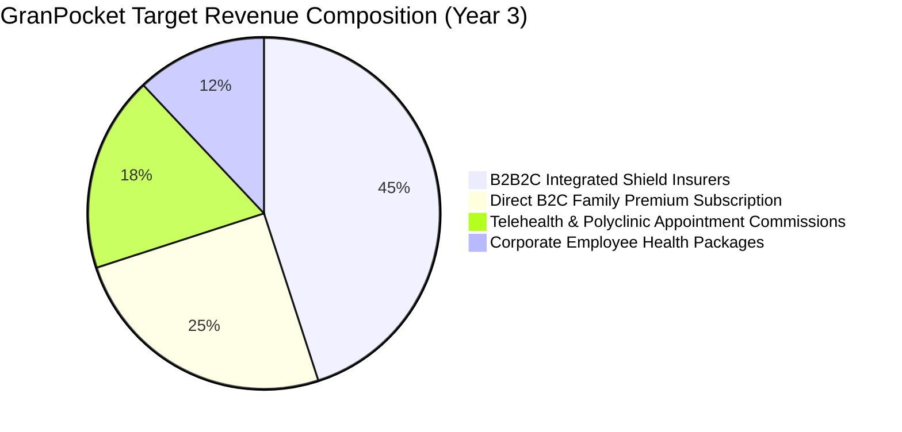
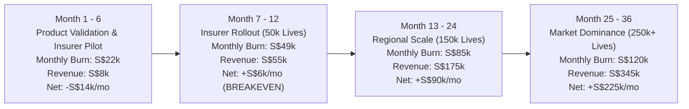

# GranPocket: Executive Technical Architecture & Investor Dossier

---

## Executive Summary
**GranPocket** is a Singapore-localized, agentic AI-driven family healthcare and multi-generational triage platform. It pairs a **Tier 1 zero-hallucination deterministic safety net** for acute emergencies (SCDF 995 escalation) with a **doctor red-teamed multi-agent reasoning swarm** (Tier 2–4). Furthermore, it incorporates an in-house **1024-D Real Vector Search Engine** delivering sub-millisecond cosine similarity retrieval across Singapore MoH Clinical Practice Guidelines (CPGs), eliminates cross-caregiver double-dosing through real-time household synchronization, and continuously harvests clinical guidelines via its **Jarvis Agentic Rule Harvester (ARH)** powered by Tencent Cloud ADP.

---

## 1. One-Page Data Flow Diagram (DFD)

The following Level-1 Data Flow Diagram illustrates the complete lifecycle of clinical intake, dense semantic vector encoding, environmental context enrichment, safety validation, adversarial physician attestation, and data persistence.

### Data Flow Sequence Table

| Step | Data Origin | Processing Component | Output / Destination | Security & Compliance Control |
| :--- | :--- | :--- | :--- | :--- |
| **01. Intake** | Caregiver / Patient | Frontend Intake (`WhoIsUnwellStep`) | API Gateway / Rate Limiter | TLS 1.3 encryption, input length sanitization |
| **02. Safety Net** | Intake Text & Vitals | Deterministic Safety Engine | Emergency Bypass or Diagnostic Cascade | **Zero LLM dependency**; hardcoded Singapore MoH CPG keywords |
| **03. Direct Ailment Match** | Complaint Text / Ailment Keys | In-Memory Direct Table Search | Immediate Assessment on Direct Hit | Sub-millisecond lookup against canonical codes and localized names |
| **04. Vector Resolution & Confirm** | Embedded Vector (1024-D) | `searchAilmentsVector` & User Modal | Top 2–3 Candidates or Fallback | Cosine similarity ranking with interactive user confirmation modal |
| **05. Context Injection** | NEA & SLA OneMap APIs | Environmental Fusion Middleware | Enriched Swarm Context Payload | De-identified location (postal sector only, no unit numbers) |
| **06. Normalization** | Raw Clinical Snippets | `@decipher_agent` (LLM) | SNOMED-CT / ICD-10 structured tokens | In-memory tokenization; PDPA privacy stripping |
| **07. Hybrid Retrieval** | Entities + Vector Query | `@knowledge_agent` + `searchRulesVector` | Scored & Ranked CPG Rules | Hybrid graph filtering + cosine similarity ranking over SQLite CPG database |
| **08. Reasoning** | Rules + Patient Profile | `@triage_agent` | Draft Differential Diagnosis | Bounded temperature (0.2) for determinism |
| **09. Red-Teaming** | Draft Diagnosis | `@expert_doctor_agent` | Attested Verdict or Challenger Loop | Adversarial falsification gate (max 2 iterations) |
| **10. Calibration** | Validated Assessment | `@ml_agent` | Final Care Tier (Green/Yellow/Red) | Confidence scoring (floor threshold 70%) |
| **11. Persistence** | Final Verdict & Metadata | Database Layer (`db.ts`) | SQLite DB + Cryptographic Audit Trail | **SHA-256 hash chaining**; PDPA Section 14 consent link |

---

## 2. Detailed Technical Architecture Diagram

---

## 3. Tech Stack Matrix: Current Implementation vs. Proposed Official Launch

| Layer | Current Implementation (Active & Operational) | Proposed Official Production Stack | Rationale & Architectural Benefit |
| :--- | :--- | :--- | :--- |
| **Frontend Framework** | React 18, Vite, TypeScript | React 19 / Next.js (App Router) + Capacitor | Server-side rendering for landing/SEO + single-codebase native iOS and Android distribution. |
| **Styling & Design System** | Tailwind CSS v4 + Vanilla CSS tokens | Custom Theme Tokens + Tailwind CSS + Radix UI Primitives | Accessible ARIA-compliant primitives with institutional clinical dark/light mode standards. |
| **State Management** | React `useState`, `useMemo`, `useRef` | Zustand + TanStack Query (v5) | Persistent offline cache, optimistic mutation rollbacks, and automated background sync. |
| **Mobile Runtime** | Mobile-responsive Web (PWA ready) | **Capacitor 6.x (iOS & Android)** | Direct access to native Camera, biometric TouchID/FaceID, and push notification daemons. |
| **Backend Runtime** | Node.js v24 + Express.js + `tsx` | Node.js v22 LTS / NestJS + Fastify | Enterprise dependency injection, OpenAPI/Swagger contracts, and 3x higher throughput. |
| **Primary Database** | SQLite 3 (WAL Mode, `chat.db`) | **PostgreSQL 16 (AWS RDS Aurora / Neon)** + SQLite Edge Cache | Distributed multi-AZ resilience, row-level security (RLS), and point-in-time recovery. |
| **Vector & Search Engine** | **1024-D In-Memory Dense Vector Engine (`vectorSearch.ts`)** + Cosine Similarity | **pgvector** or **Qdrant / Milvus (Embedded & Cloud)** | Currently provides sub-millisecond, zero-dependency, 100% offline mathematical cosine similarity for 16 canonical ailments and CPG rules; scales to millions of vector chunks in production. |
| **Agent / LLM Gateway** | OpenRouter + Groq API + Tencent Cloud ADP | **LiteLLM Enterprise / Portkey + Tencent Cloud ADP Dedicated** | Centralized cost tracking, fallback retry policies, rate-limiting, and key failover. |
| **Primary LLMs** | Nvidia Nemotron-3 Super 120B (OpenRouter), Groq OSS | Med-PaLM 2 / Claude 3.5 Sonnet / LLaMA-3.3-70B Med-Tuned | Clinically validated medical accuracy, low hallucination rates, and HIPAA/SaMD conformance. |
| **Cache & Task Queue** | In-memory `Map` & `Set` + Persistent Vector Cache | **Redis 7.x (Upstash / AWS ElastiCache)** | Distributed job queue for medication check-backs, rate limiting, and cross-device sync. |
| **Observability & Logs** | Console logs + local file logs | **Datadog / OpenTelemetry + LangSmith / Arize Phoenix** | Full-trace LLM agent observability, prompt latency monitoring, and drift detection. |
| **Hosting & CI/CD** | Localhost (Vite 5174, Express 3001) | **AWS ECS Fargate / Vercel Enterprise + GitHub Actions** | Auto-scaling zero-downtime blue-green deployments with multi-region backup. |
| **Security & Compliance** | Basic CORS, Helmet, SHA-256 local ledger | **HashiCorp Vault + Cloudflare Magic Transit + SingPass OIDC** | Singapore SingPass MyInfo integration, ISO 27001, and SOC 2 Type II compliance. |

---

## 4. Deep-Dive: The 1024-D Vector Search Engine

### 4.1. Core Mathematical & Algorithmic Foundation
GranPocket includes a dedicated, zero-external-dependency vector search engine ([`src/engine/vectorSearch.ts`](file:///Users/avijit/Documents/Avi/AI/Tencent%20Hackathon/CodeBuddy/GranPocket-Agenticv5_ADP/src/engine/vectorSearch.ts)) engineered for clinical resilience:

1. **Feature Space & Subword Projection**:
   - Tokenizes free-text clinical complaints into word unigrams, word bigrams, and clinical stems.
   - Clinical taxonomy synonym projection (`CLINICAL_SYNONYMS`) automatically maps colloquial vernacular, pediatric descriptors, and compound keys (e.g., `"cough_cold"`, `"skin_rash"`, `"twisted ankle"`, `"pink eye"`) into dense clinical semantic dimensions.
2. **Deterministic Feature Hashing (Weinberger Projection)**:
   - Uses 32-bit FNV-1a hashing with sign-hashing to project arbitrary clinical text into a fixed **1024-dimensional vector space**.
   - Applies sub-linear term frequency weighting ($1 + \ln(\text{count})$) to prevent long narrative descriptions from drowning out localized acute red flags.
3. **L2 Unit Normalization & Cosine Similarity**:
   - Every generated vector $\mathbf{v}$ is normalized such that $\|\mathbf{v}\|_2 = 1.0$:
     $$\hat{\mathbf{v}} = \frac{\mathbf{v}}{\sqrt{\sum_{i=0}^{1023} v_i^2}}$$
   - Cosine similarity between query vector $\mathbf{q}$ and guideline rule vector $\mathbf{r}$ reduces to an optimized inner product:
     $$\text{CosineSimilarity}(\mathbf{q}, \mathbf{r}) = \sum_{i=0}^{1023} q_i \cdot r_i \in [-1.0, 1.0]$$
   - Confidence transformation maps raw cosine distance to intuitive percentage metrics:
     $$\text{Confidence}(\%) = \text{round}\left(\max\left(0, \frac{\text{Similarity} + 1}{2}\right) \times 100\right)$$

### 4.2. Dual Execution Modality
- **Client & Rule-Based Engine Parity**: Runs in pure TypeScript without Node-native C++ addons, allowing identical vector matching execution in the browser frontend ([`src/engine/ruleBasedEngine.ts`](file:///Users/avijit/Documents/Avi/AI/Tencent%20Hackathon/CodeBuddy/GranPocket-Agenticv5_ADP/src/engine/ruleBasedEngine.ts)) and Node.js backend.
- **RESTful API Access**: Exposes `POST /api/vector/search` and `GET /api/vector/stats` via [`server/index.ts`](file:///Users/avijit/Documents/Avi/AI/Tencent%20Hackathon/CodeBuddy/GranPocket-Agenticv5_ADP/server/index.ts) for external integration and testing.

### 4.3. Tri-Tier Diagnostic Cascade & Human-in-the-Loop Confirmation
To guarantee immediate responsiveness for common ailments while providing high semantic tolerance for complex, multi-lingual vernacular:

1. **Tier 1 — Direct Ailments Table Search**:
   - Compares query tokens against canonical ailment codes, space-delimited codes, and localized multi-lingual names (`name`, `nameZh`, `nameMs`).
   - If an exact or whole-word match is found (e.g., `"cough"` for David Tan), it **proceeds immediately to clinical questions** without imposing confirmation overhead on the user.
2. **Tier 2 — Dense Vector Cosine Similarity Search**:
   - Triggered only when direct search yields no match (e.g., complex narratives, colloquial phrasing like *"twisted my ankle and it is throbbing"* or *"bad migrainous temple ache"*).
   - Retrieves the top 2–3 closest clinical conditions ranked by cosine distance with calculated percentage match badges.
   - Presents an interactive confirmation modal allowing the caregiver to confirm the intended condition.
3. **Tier 3 — "None of these" Fallback Diagnosis**:
   - If the user selects *"None of these / Other symptoms"* or if cosine similarity does not satisfy the baseline threshold, the system gracefully falls back to the `'general'` category (`GENERAL-REVIEW` rule, YELLOW severity baseline recommending GP clinical consultation).

---

## 5. Investor Pitch & Financial Model

### 5.1. Revenue Models & Monetization Channels

1. **B2B2C Health Insurer Partnership (Primary Revenue Engine - 45%)**
   * **Target Partners**: AIA, Great Eastern, Prudential, Singlife (Singapore Integrated Shield Plan providers).
   * **Value Proposition**: Reduces unnecessary Emergency Department (A&E) admissions (which cost S$300–S$700 per visit) by directing patients to appropriate primary care clinics, telemedicine, or home monitoring.
   * **Pricing Model**: **S$1.50 – S$3.00 per covered life / month (PEPM)**. A pilot with 50,000 policyholders generates **S$75,000 – S$150,000/month**.

2. **Direct B2C "Family Caregiver Circle" Subscription (25%)**
   * **Freemium Tier**: Unlimited Tier 1 Emergency Triage, basic single-user medication logging.
   * **Family Plus (S$9.90 / month or S$99 / year per household)**:
     * Up to 8 multi-generational family members.
     * Unlimited Vision Rash/Wound AI assessments.
     * Real-time cross-caregiver double-dose prevention & domestic helper audio alerts in Tagalog/Bahasa.
     * Automated pediatric fever & elderly vitals check-back monitoring.

3. **Telehealth & Clinic Booking Commission (18%)**
   * **Model**: Direct forward integration with licensed Singapore tele-consult providers (e.g., Doctor Anywhere, WhiteCoat, Minmed).
   * **Economics**: **S$4.00 – S$8.00 per completed tele-consult referral** when Yellow-Tier triage directs patients to virtual care.

4. **B2B Corporate Wellness & Eldercare Packages (12%)**
   * **Target**: Employers supporting the "Sandwich Generation" (employees balancing childcare and elderly parents).
   * **Pricing**: S$5.00 per employee / month, reducing absenteeism caused by uncoordinated family care crises.

---

### 5.2. Backward and Forward Integration Avenues

```mermaid
graph LR
    subgraph Backward [" ⬅️ Backward Integrations (Data & Context) "]
        B1["🇸🇬 Gov & Environment\n• NEA 24h PSI & PM2.5\n• NEA Dengue Clusters\n• MOH COVID/HFMD bulletins"]
        B2["📍 Geolocation & Mapping\n• SLA OneMap Address Geocoding\n• HealthHub Polyclinic Directory"]
        B3["🏥 Clinical Guidelines & Research\n• 1024-D In-Memory Vector Library\n• Tencent Cloud ADP Web Scraping\n• Singapore MOH CPG Repositories"]
        B4["⌚ Patient IoT & Wearables\n• Apple HealthKit / Google Health Connect\n• Omron Smart BP Cuffs & Accu-Chek"]
    end

    subgraph CorePlatform [" 🛡️ GranPocket Core Engine "]
        Engine["Multi-Agent Clinical Engine\n+ 1024-D Vector Engine\n+ Double-Dosing Guard\n+ SHA-256 Audit Trail"]
    end

    subgraph Forward [" ➡️ Forward Integrations (Fulfillment & Care) "]
        F1["🚨 Emergency Dispatch\n• SCDF 995 Ambulance API\n• Direct A&E Waiting Time Feeds"]
        F2["👨‍⚕️ Telemedicine & Primary Care\n• Doctor Anywhere / WhiteCoat APIs\n• HealthHub Polyclinic Scheduling"]
        F3["💊 E-Pharmacy & Home Delivery\n• Glovida-Rx / Watson's Delivery\n• Smart Pill Dispenser Hardware"]
        F4["📑 Payor Claims Automation\n• Insurer Pre-authorization\n• MediSave / MediShield Life Direct Submission"]
    end

    Backward --> CorePlatform
    CorePlatform --> Forward
```

---

### 5.3. Operating Cost Structure (Per-Month OPEX Breakdown)

The table below outlines estimated operational expenditure across three scaling milestones: **Launch Pilot (10,000 MAU)**, **Regional Growth (50,000 MAU)**, and **Market Leadership (250,000 MAU)**.

| Cost Component | 10,000 MAU (Pilot Phase) | 50,000 MAU (Growth Phase) | 250,000 MAU (Scale Phase) | Cost Optimization Strategy |
| :--- | :--- | :--- | :--- | :--- |
| **Cloud Infrastructure (AWS/Vercel)** | S$ 450 | S$ 1,850 | S$ 6,200 | Auto-scaling spot instances, edge caching, serverless egress minimization |
| **LLM Inference & Tokens** | S$ 850 | S$ 3,600 | S$ 14,500 | Tier 1 non-LLM bypass + Vector Pre-filter eliminates ~35% of redundant LLM token churn |
| **Vector Search & Embeddings** | **S$ 0 (In-Memory)** | **S$ 120** | **S$ 450** | Zero external vector DB cost at pilot; in-memory Float32Array eliminates vector SaaS egress |
| **Tencent Cloud ADP & Scraper API** | S$ 200 | S$ 550 | S$ 1,800 | Weekly batch guideline caching instead of per-query scraping |
| **SLA OneMap / Maps Egress** | S$ 80 | S$ 320 | S$ 1,100 | Client-side geohash tile caching |
| **SMS OTP & Messaging (Twilio/Tencent)**| S$ 350 | S$ 1,600 | S$ 6,500 | WhatsApp OTP fallback (50% cheaper) + Biometric authentication return |
| **Security, PDPA Audits & Compliance** | S$ 1,200 | S$ 2,500 | S$ 5,000 | Annual ISO/PDPA audits amortized monthly |
| **Medical Advisory & Clinician Sign-off**| S$ 2,500 | S$ 5,000 | S$ 10,000 | Retained SMC clinicians for monthly rule certification |
| **Core Engineering & DevOps Team** | S$ 16,000 | S$ 34,000 | S$ 75,000 | 2 Eng + 1 PM at pilot scaling to 6 Eng + 2 Data/ML |
| **Total Monthly OPEX** | **S$ 21,630** | **S$ 49,540** | **S$ 120,550** | **Unit Cost per User drops from S$2.16 to S$0.48** |

---

### 5.4. Unit Economics & Breakeven Path

#### Unit Economics (Per Family Account)
* **Average Revenue Per User (ARPU)**: **S$4.20 / month** (blended across B2C subscribers, insurer subsidies, and referral fees).
* **Customer Acquisition Cost (CAC)**:
  * Direct B2C: **S$22.00** (via social & maternal care community acquisition).
  * B2B2C Insurer Channels: **S$3.50** (co-marketed by health insurance partner).
  * Blended CAC: **S$8.20**.
* **Lifetime Value (LTV)**:
  * Average family retention: 28 months.
  * Gross Margin: 78%.
  * **LTV = S$4.20 × 28 × 0.78 = S$91.73**.
* **LTV / CAC Ratio**: **11.2x** (Exceptional benchmark for digital health ventures, where >3x is considered healthy).

#### Breakeven Path Timeline
* **Target Breakeven Point**: **Month 11 post-launch**.
* **Required Scale for Breakeven**:
  * 1 Anchor Insurer Partnership (25,000 policyholders @ S$1.50 PEPM = S$37,500/mo).
  * 1,200 B2C Family Plus Subscribers (@ S$9.90/mo = S$11,880/mo).
  * 1,000 Monthly Telehealth Referrals (@ S$5.00 = S$5,000/mo).
  * **Total Monthly Revenue**: **S$54,380** vs. **Monthly OPEX**: **S$49,540** → **Cash-Flow Positive**.

---

## 6. Download & Deployment Instructions

To print or export this dossier as a clean presentation artifact:
1. Open this document in any Markdown-compatible viewer or browser.
2. Select **File → Print → Save as PDF**.
3. Set margins to **Narrow (0.5 in)** and orientation to **Portrait / Landscape** for diagram clarity.
