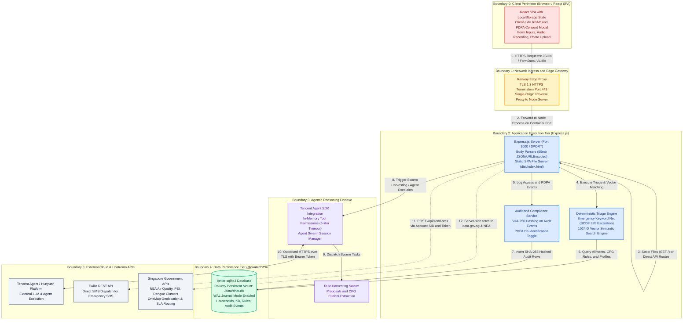

# GranPocket Trust Boundary & Threat Architecture

> **Direct Downloads**:
> - 📄 **PDF Document**: [GranPocket_Trust_Boundary_Diagram.pdf](file:///Users/avijit/Documents/Avi/AI/Tencent%20Hackathon/CodeBuddy/GranPocket-Agenticv5_ADP/GranPocket_Trust_Boundary_Diagram.pdf)
> - 🖼️ **High-Res PNG**: [GranPocket_Trust_Boundary_Diagram.png](file:///Users/avijit/Documents/Avi/AI/Tencent%20Hackathon/CodeBuddy/GranPocket-Agenticv5_ADP/GranPocket_Trust_Boundary_Diagram.png)
> - 📐 **Vector SVG**: [GranPocket_Trust_Boundary_Diagram.svg](file:///Users/avijit/Documents/Avi/AI/Tencent%20Hackathon/CodeBuddy/GranPocket-Agenticv5_ADP/GranPocket_Trust_Boundary_Diagram.svg)

---

## Architecture Diagram (Rendered)

---

## Mermaid Source Specification

---

## Trust Boundary Definition Matrix: Implemented vs. Future Controls

| Boundary Zone | Components Included | Security Level | Currently Implemented in Codebase | Future Planned Controls (Roadmap) |
| :--- | :--- | :--- | :--- | :--- |
| **Boundary 0: Client Perimeter** | Web browsers, Mobile PWAs, End Users, Clinic Admins | **Zero Trust (Untrusted)** | • Client-side input validation and payload structuring • Frontend RBAC screen filtering (`defaultRbac.ts`) • Session persistence via browser `localStorage` • Mandatory PDPA consent modal upon household signup (`CreateHouseholdModal.tsx`) | • Enforced idle session timeout (auto-logout after 15–30 mins) • Client-side CSRF tokens or HttpOnly secure cookies • Client-side payload encryption for uploaded photos/audio |
| **Boundary 1: Network Ingress & Edge** | Edge Reverse Proxy, Railway Ingress, Vite Static Server | **Perimeter Control** | • TLS 1.3 encryption on transit (enforced at Railway edge) • Express JSON body parsing with payload cap (`50mb` limit) • Static assets and API consolidated onto single origin to minimize CORS exposure | • Explicit CORS origin allowlisting (locking mutating endpoints to trusted domain) • Web Application Firewall (WAF) & IP rate-limiting middleware (`express-rate-limit`) • Security headers via `helmet.js` (HSTS, CSP, X-Frame-Options) |
| **Boundary 2: Application Compute** | Node.js Express Server, Deterministic Triage Engine | **Trusted Zone** | • Deterministic safety-first triage rule evaluation before AI delegation • Explicit CareLink relationship checks (caregiver vs. dependent) • SHA-256 hash generation for immutable audit events (`server/db.ts`) • PII de-identification flag and prompt sanitization logic (`AppOwnerPortalView.tsx`) | • Server-side JWT / session validation middleware on all `/api/db/*` routes • Strict role-based authorization verification directly in Express request handlers • Automated regex/NLP PII detection middleware before any downstream processing |
| **Boundary 3: AI Reasoning Enclave** | Tencent Agent SDK, Agent Swarms (`@decipher`, `@extractor`), Guardrails | **Restricted / Sandboxed** | • In-memory tool execution timeout (`PERMISSION_TIMEOUT = 5 mins`) • Sandboxed agent sessions via `unstable_v2_createSession` • Explicit tool permission resolution gate (`pendingPermissions.set`) • Pre-commit clinical rule validation before persisting proposals | • Isolated container / WebWorker execution for custom agent scripts • Differential privacy / k-anonymity scoring on harvested clinical knowledge • Real-time adversarial prompt injection detection filter |
| **Boundary 4: Persistent Storage** | Railway Mount `/data/chat.db`, SQLite WAL files, Audit Logs | **Confidential / High Trust** | • Isolated container filesystem with volume mounting (`/data/chat.db`) • WAL mode enabled (`PRAGMA journal_mode = WAL`) for ACID durability • Tamper-evident audit table (`audit_events`) logging actions and regimes • Database seeding verification on first mount (`server/db.ts`) | • At-rest database encryption via SQLCipher / envelope encryption • Cryptographic merkle tree / hash-chain verification for audit log entries • Automated scheduled off-site encrypted volume snapshots |
| **Boundary 5: External Upstream Providers** | Tencent Hunyuan API, Twilio SMS, SG MOH / OneMap APIs | **Third-Party Boundary** | • Server-to-server outbound TLS 1.3 communication • API secrets isolated in server environment variables (`.env` / Railway Env) • Zero personal identifiers forwarded to external weather/health APIs (OneMap, NEA) | • Outbound egress proxy and network egress allowlisting • Automated secret rotation and KMS integration for Twilio and Tencent API keys • Cryptographic payload signing for third-party webhook verification |
