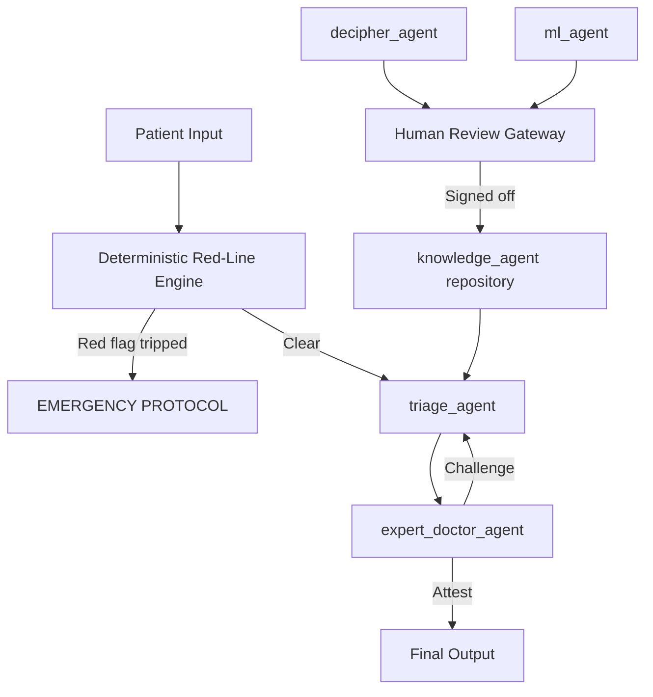

# Granpocket — Agent-Based Triage Workflow: Technical Specification

**Version:** 0.1 (Spec-Driven Development Draft) **Scope:** Multi-agent pipeline for clinical knowledge ingestion, triage classification, and adversarial safety review.

---

## 1. Design Principles

1. **Deterministic code owns emergencies, not LLMs.** Red-flag conditions (chest pain, stroke FAST, anaphylaxis, etc.) are caught by hardcoded rules that bypass every agent. LLMs assist reasoning; they never gate life-threatening decisions alone.
2. **Agents synthesize, humans authorize.** Any write to the production knowledge base requires explicit clinician sign-off — no automated pipeline has direct write access.
3. **State machine, not free-form agent chat.** Orchestration (LangGraph/Temporal) enforces a fixed sequence and prevents loops or gateway bypass.
4. **Every decision is auditable.** Each agent output includes rationale, source references, and a confidence score.

---

## 2. Architecture Overview



**Tiers:**

- **Tier 1 — Deterministic Safety Net:** hardcoded, non-LLM, always runs first.
- **Tier 2 — Parsing & Knowledge Management:** `decipher_agent`, `knowledge_agent`.
- **Tier 3 — Clinical Evaluation & Adversarial:** `triage_agent`, `expert_doctor_agent`.
- **Tier 4 — Optimization & Governance:** `ml_agent`, Human Review Gateway.

---

## 3. Deterministic Safety Net (Tier 1)

**Why:** LLMs and retrieval pipelines can hallucinate or misweight rare-but-fatal presentations. Red-line logic must never depend on them.

| Property | Spec |
| --- | --- |
| Implementation | Plain deterministic code (no model calls), versioned and unit-tested like production infra code |
| Trigger inputs | Structured symptom flags + free-text keyword/pattern match (pre-LLM regex/keyword layer) |
| Behavior on trip | Immediately halts agent pipeline, returns `EMERGENCY` classification, surfaces ambulance/ED action, logs event with 100% audit trail |
| Update process | Rule changes go through the same Human Review Gateway as knowledge base changes — never silently patched |
| Test requirement | Golden-set regression suite run on every deploy; zero tolerance for false negatives on this suite |

### 3.1 Red-Line Symptom List — Infants (age-banded)

| Category | Trigger |
| --- | --- |
| Breathing distress | Labored/rapid breathing, flared nostrils, deep chest/rib retractions |
| Skin/lip discoloration | Pale, blotchy, gray, or blue skin, lips, or tongue |
| Newborn fever | Temperature ≥ 100.4°F (38°C) in an infant under 3 months — automatic emergency, no exceptions |
| Extreme lethargy | Unusually drowsy, unresponsive, limp, or hard to wake |
| Inconsolable crying | Continuous, high-pitched crying unresponsive to normal soothing |
| Severe dehydration | Dry mouth, crying without tears, no wet diaper for several hours |
| Feeding refusal | Total inability or refusal to breastfeed/bottle-feed |
| Neurological signs | Seizure activity, rhythmic jerking, sudden staring spells |
| Dangerous rash | Dark red/purple rash that does not blanch under pressure (glass test) |

### 3.2 Red-Line Symptom List — Seniors

| Category | Trigger |
| --- | --- |
| Sudden confusion | Abrupt change in mental status, disorientation, sudden loss of speech clarity |
| Chest pain/pressure | Any squeezing, pain, or heavy pressure in the chest |
| Shortness of breath | Sudden gasping, wheezing, or inability to catch breath at rest |
| Stroke signs | Sudden one-sided numbness/weakness, facial drooping, loss of balance/gait |
| High fever | ≥ 103°F (39.4°C), or lower fever with stiff neck, confusion, or chills |
| Severe dehydration | Sunken eyes, confusion, dark urine, dizziness/fainting from persistent vomiting or diarrhea |
| Sudden severe pain | Abrupt, intense abdominal pain or a sudden severe headache |

**Note:** these lists are the v1 seed set for the deterministic engine, not the final clinical sign-off — they still route through the Human Review Gateway (Section 6) before becoming production rules, and are expected to be expanded/refined with clinician input per the age-band and body-part taxonomy `@knowledge_agent` uses.

---

## 4. Agent Specifications

### Tier 2 — Parsing & Knowledge Management

| Field | `@decipher_agent` | `@knowledge_agent` |
| --- | --- | --- |
| Role | Multi-format document parser & normalizer | Repository maintainer + semantic retrieval |
| Inputs | Clinical PDFs, CSV medical DBs, legacy guideline sheets, text exports (symptoms, medicines, triage criteria) | Age-based & body-part-based diagnostic criteria mapped to symptoms |
| Core behavior | Extracts unstructured knowledge; maps terminology to ICD-10 / SNOMED-CT; emits normalized Markdown/JSON blocks | Hybrid vector + graph DB interface; serves structured diagnostic trees to `triage_agent` |
| Write access | **None** — output routed to Human Review Gateway only | **Read-only for agents**; rejects unverified automated inserts; writes only via Gateway-approved sign-off |
| Output schema | `{source_id, entity_type, raw_text, normalized_term, code_system, code, confidence}` | `{condition_id, age_band, body_part, symptom_set[], severity_tier, source_refs[], version}` |
| Failure mode | Low-confidence extraction → flagged, not silently accepted | Query with no match → returns "insufficient evidence," never a guessed answer |

**`@knowledge_agent` storage strategy (hybrid):** the agent is not locked to a single backend — it selects vector vs. graph retrieval per query shape rather than the system committing to one globally.

- **Graph store** is primary for relationship-heavy queries: symptom → condition → severity-tier pathways, age-band/body-part taxonomy traversal, and anything `triage_agent` needs an explainable path for (the graph edge *is* the rationale).
- **Vector store** is primary for fuzzy/semantic matching: free-text symptom descriptions from `@patient_agent` that don't map cleanly to a taxonomy node, or `@decipher_agent` output before it's been fully normalized.
- Typical flow: vector search narrows candidate conditions → graph traversal confirms the structured pathway and supplies the auditable rule chain returned to `triage_agent`.
- Both stores are populated only via the Human Review Gateway — the hybrid choice affects retrieval, not the write-access model in the table above.

### Tier 3 — Clinical Evaluation & Adversarial

**`@triage_agent`** — Primary clinical reasoning engine.

- Inputs: `@patient_agent` payload, `@environment_agent` context, retrieved rules from `@knowledge_agent`.
- Runs *after* the Tier 1 red-line check clears.
- Output paths: `EMERGENCY` (should rarely fire here — normally caught by Tier 1), `TELEDOCTOR`, `HOME_MONITOR`.
- Output object: `{classification, rationale, confidence, safety_warnings[], monitoring_timer, source_refs[]}`.
- Constraint: must cite `knowledge_agent` source refs for every rule applied — no unsourced reasoning.

**`@expert_doctor_agent`** — Adversarial red-team / falsifier.

- Input: draft `triage_agent` output.
- Checks: missed differentials, allergy/OTC contraindications, edge cases, inconsistent severity vs. symptoms.
- Output: `ATTESTATION_APPROVED` or `CHALLENGE_FLAG {reason, required_revision}`.
- On challenge: routes back to `triage_agent` with a bounded retry count (state machine enforced, e.g. max 2 revisions) before automatic escalation to human clinician.

### Tier 4 — Optimization & Governance

**`@ml_agent`** — Model performance calibrator.

- Inputs: anonymized historical triage logs, outcome tracking, clinician feedback.
- Behavior: recalibrates confidence weights for recurring symptom patterns; **proposes** threshold updates only.
- Constraint: never writes directly to `knowledge_agent`; all outputs go to the Gateway as proposals with supporting evidence.

**Human Review / Attestation Gateway**

- Intercepts every proposed change from `@ml_agent` and `@decipher_agent` targeting the knowledge repository.
- Presents: diff view, ML confidence calibration, supporting source references.
- Requires explicit clinician cryptographic signature or UI sign-off before any production write.
- No auto-approval path exists, regardless of confidence score.

---

## 5. Orchestration & State Machine

Enforced via LangGraph/Temporal (not free-form agent-to-agent chat):

```
Patient Input
  → Red-Line Deterministic Check
      → [tripped] → Emergency Protocol (terminal)
      → [clear] → Triage Draft (@triage_agent)
          → Expert Doctor Challenge (@expert_doctor_agent)
              → [approved] → Final Output (terminal)
              → [challenged] → back to Triage Draft (max 2 retries)
                  → [retries exhausted] → Human Clinician Escalation (terminal)
```

Separately, and asynchronously from the patient-facing path:

```
Dataset Ingest (@decipher_agent) → Human Review Gateway → Knowledge Repository (@knowledge_agent)
Feedback Logs (@ml_agent) → Human Review Gateway → Knowledge Repository (@knowledge_agent)
```

**Guarantees the state machine must enforce:**

- No agent can write to the knowledge repository directly.
- No infinite loop between `triage_agent` and `expert_doctor_agent` (hard retry cap).
- Red-line check always executes first and cannot be skipped, cached-around, or reordered.
- Every state transition is logged with timestamp, agent, input hash, and output.

---

## 6. Clinical Guardrails (Hard Stops)

- **Allergy/contraindication hard stop:** any OTC/teledoctor recommendation conflicting with a logged patient allergy is blocked pre-output, independent of `expert_doctor_agent` review.
- **Age hard stop:** infants/elderly below/above defined age thresholds are never routed to `HOME_MONITOR` for a defined set of symptom categories (e.g., infant fever, elderly fall) — forced to at least `TELEDOCTOR`.
- **Confidence floor:** if `triage_agent` confidence for the selected tier falls below a configurable threshold, output is forced to the more conservative tier, never the least conservative. Threshold is a per-severity-tier config value (not hardcoded), **default 80%** — adjustable via the Human Review Gateway's config surface, with changes logged and versioned like any other governance change.
- **Repository staleness stop:** if `knowledge_agent` cannot confirm the retrieved rule's version is within a defined freshness window, `triage_agent` must flag "unverified guidance" and escalate rather than silently proceeding.
- **No self-approval:** `@ml_agent` and `@decipher_agent` can never satisfy their own Gateway review — sign-off must be a human role, enforced at the auth layer, not just UI convention.

---

## 7. Non-Functional Requirements

| Area | Requirement |
| --- | --- |
| Auditability | Every agent decision persisted with rationale + source refs; immutable log |
| Compliance | PDPA-aware handling of patient data; anonymization before `@ml_agent` ingestion |
| Latency | Red-line check: near-instant (no model call); full triage path: bounded SLA (e.g., \<10s) |
| Versioning | Knowledge repository entries are versioned; rollback supported |
| Testing | Golden-set regression for red-line rules run pre-deploy, zero false-negative tolerance |

---

## 8. Open Items for Spec-Driven Build

- Clinician sign-off on the v1 red-line list in Sections 3.1/3.2 before it goes live (seed set only, not yet production-approved).
- Extend red-line coverage beyond infants/seniors to general adult population, per the same age-band taxonomy.
- Define retry cap and escalation SLA for `expert_doctor_agent` challenges.
- Define exact vector/graph routing heuristics for `@knowledge_agent` (query-shape classifier).
- Validate the 80% default confidence threshold per severity tier against golden-set performance; adjust per tier as data comes in.